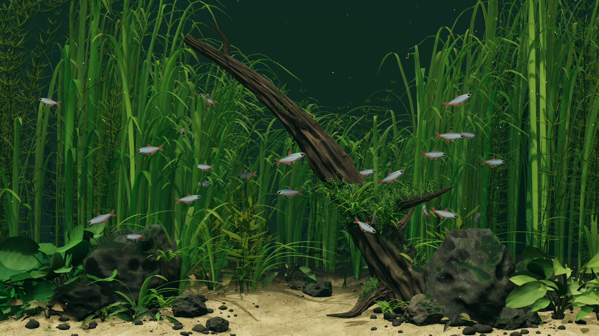

# 桌面生态缸 · Desktop Ecosphere

为 Windows 桌面添加实时淡水生态缸或珊瑚海水缸。基于 C#、WinForms、WebView2 和 Three.js/WebGL2，离线运行。

当前版本：**v0.11.0** · 仓库：[NotBeBarnon/desktop-ecosphere](https://github.com/NotBeBarnon/desktop-ecosphere)



## 功能

- 预览窗口、主屏/多屏桌面壁纸、每屏独立场景。
- 托盘控制、中文设置、开机启动、画质和帧率设置。
- 电池限帧或暂停、关屏/锁屏暂停、窗口遮挡节能。
- 投食份量、自动投食、鼠标互动开关。
- 清静、标准、热闹三档鱼群密度，设置后重新加载场景。
- 自定义淡水鱼及两类海水群游鱼的数量。
- 场景异常最多自动重试两次，支持手动重新加载。
- 实时状态、本地 JSON 诊断、壁纸窗口失效恢复。
- 设置导入、导出和恢复默认，支持迁移已有配置。
- 灯光亮度与可选的本地时间昼夜渐变。
- 关于页面和手动 GitHub 版本检查。
- 按体长弯曲的海水鱼转向、与转向意图衔接的身体动作。
- 当前用户安装、快捷方式和卸载入口。

## 运行与编译

要求 Windows 10/11 x64、.NET Framework 4.8、[WebView2 Runtime](https://developer.microsoft.com/microsoft-edge/webview2/) 和支持 WebGL2 的显卡驱动。

双击 `启动生态缸.cmd`。首次编译联网下载 WebView2 开发包；应用运行不需要 Node.js 或 .NET SDK。

```powershell
powershell.exe -NoProfile -ExecutionPolicy Bypass -File .\windows\build.ps1
powershell.exe -NoProfile -ExecutionPolicy Bypass -File .\windows\build-installer.ps1
```

产物为 `dist/DesktopEcosphere-v0.11/DesktopEcosphere.exe`、`dist/DesktopEcosphere-Windows-x64-v0.11.zip` 和 `dist/DesktopEcosphere-Setup-v0.11.exe`。

安装位置为 `%LOCALAPPDATA%/Programs/DesktopEcosphere`，无需管理员权限。安装包不包含 WebView2 Runtime，尚未代码签名。升级前先从托盘退出旧版。

为兼容早期版本，配置、缓存目录继续使用 `%LOCALAPPDATA%/DesktopHabitatsWindows/`，内部启动项标识也保留原名称。卸载保留用户自建文件和目录；临时目录可能留有清理程序副本。

## 使用

点击“设为桌面壁纸”，然后通过托盘右键投食、暂停或打开设置。双击托盘图标返回预览。退出关闭壁纸窗口，不更改原静态壁纸。

自动投食默认关闭，只有场景运行时计时。暂停、关屏和停止渲染期间不累积补投；手动投食后重新计时。每份沿用场景原有投食量。鼠标开关控制鱼群响应和预览窗口点击投食。

“设置 → 常规 → 鱼群密度”可选择数量：淡水缸 12 / 24 / 36 条；海水缸 12 / 19 / 28 条鱼，另有 2 只虾。海水缸保留 3 条小丑鱼，其余变化来自两类群游鱼。热闹档会增加模拟和绘制开销；默认仍为标准档。切换档位重建场景，当前投食状态不保留。

## 生物数量

“设置 → 生物数量”可启用自定义数量，替代常规页面的密度档位。淡水群游鱼支持 1–48 条，蓝绿海水群游鱼（Chromis）支持 2–18 条，橙紫海水群游鱼（Anthias）支持 2–14 条。小丑鱼固定 3 条、虾固定 2 只，两类海水群游鱼最少各 2 条。当前支持调整已有鱼种，不提供新增模型或移除整类鱼种。

设置对所有显示器生效；保存后重新加载场景，当前投食状态不保留。关闭自定义模式会恢复所选密度档位，但保留输入的自定义数量以供下次使用。增加数量会提高模拟和渲染开销。

## 灯光

“设置 → 灯光”支持 25%–150% 亮度，默认 100% 保持原场景曝光。启用昼夜变化后，按 Windows 本地时间在 6–8 点渐亮、18–20 点渐暗，夜间保持设定亮度的 35%。夜间不完全熄灯，不模拟鱼类睡眠或改变生物行为。

停止渲染时不持续刷新灯光，恢复后同步当前时间。手动保存新亮度会重新加载场景；暂停状态下可绘制一帧新亮度，动画仍保持暂停。实际亮度还受色调映射、显示器和场景材质影响，百分比不代表物理照度。

## 设置文件

在“设置 → 设置文件”中导入或导出 JSON，或恢复默认值。导入及恢复默认只改变草稿，保存后生效，取消保留已有设置；导出包含当前界面尚未保存的调整。

文件包括场景、画质、鱼群密度、互动、投食、节能和每屏场景，不携带开机启动、当前壁纸模式和暂停状态。恢复默认也保留开机启动选择。支持带格式标识和版本号的便携文件，以及旧版本原始 `settings.json`。缺少的选项采用默认值，离线屏幕设置保留；错误值、不支持的版本或超过 64 KB 的文件会被拒绝。

## 关于与更新

“设置 → 关于与更新”显示应用版本、系统/CLR 环境和项目入口。只有点击“检查更新”时才向 GitHub 发起公开查询，不读取 Git 登录凭据，不上传个人设置，不自动下载安装程序。

优先查询本仓库最新正式 Release；没有 Release 时查询最近 100 个标签中的最高稳定版本。草稿、预发布和非三段式版本号不参加比较。标签只提供源码入口，不能替代已发布的安装包。API 超时、限流或离线时提示检查不可用，可自行打开 GitHub 版本页查看。

当前仓库以提交和标签发布源码，尚未上传 GitHub Release 安装包；安装产物仍由本地打包脚本生成。

## 验证

```powershell
powershell.exe -NoProfile -ExecutionPolicy Bypass -File .\windows\test-policy.ps1
node .\upstream\scenes\shared\population.test.mjs
node .\upstream\scenes\shared\lighting.test.mjs
node .\upstream\scenes\reefscape\tests\turn-flex.mjs
.\dist\DesktopEcosphere-v0.11\DesktopEcosphere.exe --smoke-test
powershell.exe -NoProfile -ExecutionPolicy Bypass -File .\windows\verify.ps1
```

烟雾测试临时打开场景、设置和壁纸窗口，完成后还原并退出。输出诊断与截图，不保存用户设置或开启自启动。电源集成测试模拟本程序收到的消息，不实际关闭显示器。

离线策略测试包括更新响应、版本比较、标签回退、取消及限流；UI 测试注入固定响应，不会隐式联网。可选运行 `windows/test-updates.ps1` 查询真实 GitHub API；此步骤依赖网络及未认证 API 配额，本次环境实际返回了限流提示。

安装器支持 `--integration-test <不存在的测试目录>`，在隔离目录验证安装资源、快捷方式目标、卸载和用户文件保护，不修改用户桌面、开始菜单或注册表。

## 已知限制

- 当前仅在一台实体显示器上验证。多屏混合 DPI、热插拔、真实电池切换/关屏、Explorer 实际重启仍需硬件验收。
- 遮挡按窗口矩形联合面积估算，覆盖 ≥70% 时最高 10 FPS，≥98% 时暂停；透明窗口可能产生估算偏差。
- 帧率是上限，实际表现受显卡、画质和节能状态影响。
- WorkerW 不是微软公开承诺稳定的壁纸接口，不同系统构建可能有差异。
- 尚无代码签名、自动下载安装更新、新鱼种模型、生物作息系统或养成存档。

## 版本提交

每个可交付版本单独 commit、push，并创建对应版本标签，详见 [CHANGELOG.md](CHANGELOG.md)。v0.1–v0.4 为本地原型，未保留完整源码快照，不补造历史提交。

依赖包、构建产物、缓存及测试截图不进入源码仓库。

## 来源与许可

原场景来自 Chase Lean 的 [Desktop Habitats](https://gitee.com/ctguhzy/desktop-habitats)，导入提交为 `66e80ea1b6bafd25324c84c72067e750c1a1f334`。源文件、原 macOS 宿主与说明保留在 `upstream/`，根目录描述本项目的 Windows 实现。

本项目采用 [MIT](LICENSE)。上游、Three.js 和素材保留原版权及许可，见 [上游许可](upstream/LICENSE)、`upstream/vendor/` 和场景资源目录。
